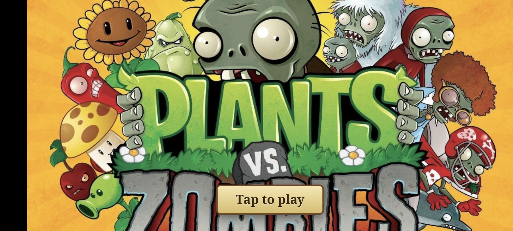
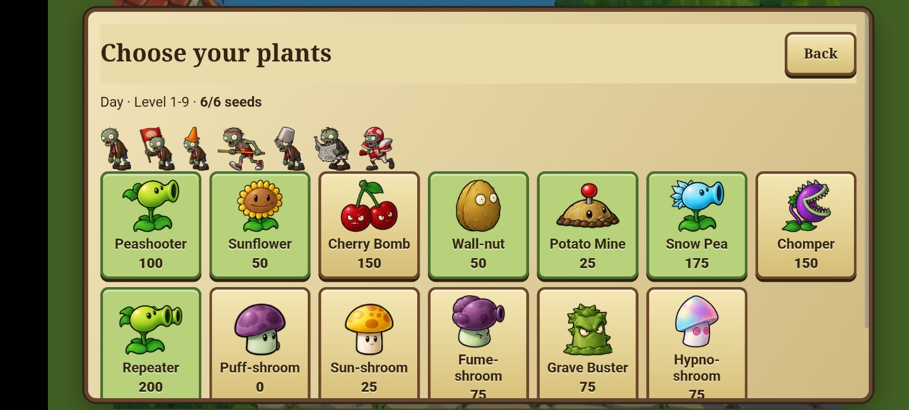
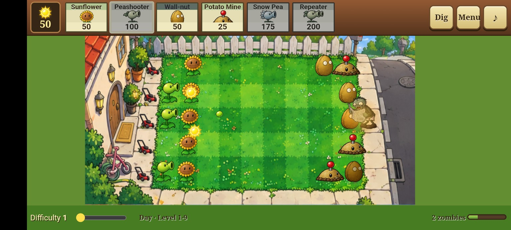

  

<h1 align="center">Lawn Defense</h1>

  <strong>A Plants vs. Zombies-inspired lawn-defense game you can play in your browser.</strong>

  <a href="https://lawn-defense-thomas.benclawbot.chatgpt.site/"><strong>▶ Play Lawn Defense</strong></a>

---

## The game

Defend your lawn from waves of zombies in a lane-based strategy game inspired by *Plants vs. Zombies*. Build a team of plants, manage your sun, and place attackers and defenses to keep the zombies away from your house.

- **Choose your team** — Pick six seed packets before a level, each with its own sun cost.
- **Plan your defense** — Place Peashooters, Sunflowers, Wall-nuts, Potato Mines, and more across the lawn.
- **Manage resources** — Collect sun to afford your next plant while zombies approach.
- **Survive the waves** — Adapt your lineup as different zombies attack your lanes.

## Screenshots

### Choose your plants

### Defend the lawn

## Play online

**[Launch Lawn Defense →](https://lawn-defense-thomas.benclawbot.chatgpt.site/)**

The playable version is hosted on **ChatGPT Sites** and opens directly in a web browser.

## Repository status

This repository contains the project's screenshots and documentation. **The original game source code has not yet been exported from ChatGPT Sites.** The live deployment is hosted separately, so changes to this repository do not automatically update the game.

---

Fan-made project inspired by *Plants vs. Zombies*. Not affiliated with, endorsed by, or sponsored by PopCap Games or Electronic Arts. Original game names and characters belong to their respective owners.
